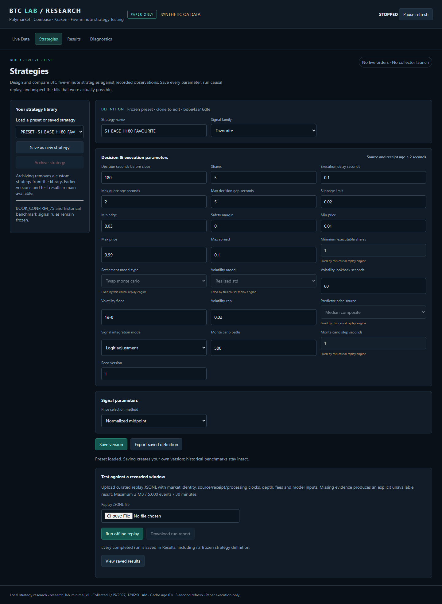

<p align="center"></p>
<h1 align="center">BTC LAB</h1>
<p align="center"><strong>Test the idea. Trust the evidence.</strong><br>A local strategy research workbench for BTC five-minute prediction markets.</p>
<p align="center"><a href="https://pigheadedpeak16.github.io/btc-lab-v3/">Project website & quick start</a> · <a href="docs/USAGE.md">User guide</a> · <a href="docs/ARCHITECTURE.md">Architecture</a> · <a href="docs/REPLAY_FORMAT.md">Replay format</a></p>
<p align="center"><a href="https://github.com/pigheadedpeak16/btc-lab-v3/actions/workflows/tests.yml"></a>  </p>

BTC LAB records market observations, makes data-quality failures visible, and tests strategies against the fills the supplied order book actually allows. It is a **research project and shadow-paper strategy tester**. It does not submit real-money orders or promise profitable strategies.



*Product screenshot from a synthetic QA fixture. This is not a live market or a performance result.*

## What you can do

- Inspect Polymarket order-book observations alongside Coinbase, Kraken and the official market reference.
- Distinguish source freshness, receipt freshness, synchronization, model availability and execution eligibility.
- Configure **seven strategy families**: favourite, fair value, momentum, mean reversion, book imbalance, microstructure and cross-exchange.
- Save immutable strategy revisions, export definitions and archive custom strategies without deleting their history.
- Replay recorded windows through causal features, fees, sizing, latency, market expiry and depth-limited execution.
- Inspect partial fills, rejection reasons, unresolved markets and net shadow PnL after a supplied resolution is validated.
- Open the same saved run in **Results** with its strategy version and execution provenance intact.

The four tabs are **Live Data · Strategies · Results · Diagnostics**. Frozen historical benchmark rules, including BOOK_CONFIRM_75, remain separate from editable research strategies. There is no persistent funded account or adaptive selector in this release.

## Quick start

Requirements: **Python 3.11+**, Git, a modern browser, and internet access to install dependencies. Offline replay requires **at least 8 GiB free on both the project and temporary drives**. You do not need a wallet, API key or account for the included example.

### Windows / PowerShell

```powershell
git clone https://github.com/pigheadedpeak16/btc-lab-v3.git
cd btc-lab-v3
py -3.11 -m venv .venv
.\.venv\Scripts\python.exe -m pip install -e ".[dev]"
.\.venv\Scripts\python.exe -B -m btc_v3.forensics.browser_dashboard --root . --open
```

If you use a newer installed Python, replace `py -3.11` with `python` or your Python launcher selection. Activation is unnecessary: these commands use the virtual environment directly.

### macOS / Linux

```bash
git clone https://github.com/pigheadedpeak16/btc-lab-v3.git
cd btc-lab-v3
python3 -m venv .venv
.venv/bin/python -m pip install -e ".[dev]"
.venv/bin/python -B -m btc_v3.forensics.browser_dashboard --root . --open
```

Open **http://127.0.0.1:8592/** if your browser does not open automatically. A fresh checkout correctly shows no live observations. Opening the dashboard does not start collectors or a trading session. `Ctrl+C` in its terminal stops only that dashboard.

## Try the included replay

1. Open **Strategies** and choose the **Fair value book imbalance** preset.
2. Optionally change its name or supported parameters and select **Save version** to create your own immutable definition.
3. Under **Test against a recorded window**, choose [`examples/synthetic-btc-window.jsonl`](examples/synthetic-btc-window.jsonl).
4. Select **Run offline replay**. The input is synthetic and explicitly labeled; its outcome is not evidence of edge or historical performance.
5. Open **Results** to inspect the saved run, filled quantities, fees, coverage, version and downloadable report.

The example contains artificial Coinbase/Kraken ticks, reference observations, market identity, fees, depth and a synthetic resolution payload. Supplied resolution payloads are checked for consistency, not independently authenticated. Families may correctly choose not to trade on this window.

You can run the same saved definition from the command line. Windows:

```powershell
.\.venv\Scripts\python.exe -B -m btc_v3.cli replay-jsonl --input examples/synthetic-btc-window.jsonl --strategy-profile-json examples/book-imbalance.strategy.json --output replay-demo-report.json
```

On macOS/Linux, use `.venv/bin/python` instead. CLI outputs must be new files; they are never silently overwritten. CLI reports stay at your chosen path; the Results tab lists reports created by the web workbench.

## Live data is an explicit step

This website is a static project guide; the dashboard runs locally. Live collection requires separate operator commands, available endpoints, disk space and valid source clocks. A synchronized host clock does not make stale or incomplete exchange data usable. Strategies requiring the official reference cannot substitute an unauthenticated spot price for it.

Read the [live-data guide](docs/USAGE.md#optional-live-data-workflows) before starting collectors. Authenticated reference access is an optional advanced workflow; **the quick start and offline demo require no credentials**. Do not publish keys or put them in replay files. The implementation targets the international Polymarket interfaces; it is not a Polymarket US integration.

## How the research stays inspectable

Source time and receive time must both precede the decision. Execution checks current market identity and expiry, source/receipt book age, depth integrity, tick size, minimum submission size, fees and observed liquidity. Strategies that require both books recheck both sides at execution. Missing evidence blocks a fill; a heartbeat cannot make an old source observation fresh.

Reports preserve strategy hashes and policy revisions. Unresolved PnL stays unresolved. Different execution policies are different research cohorts; do not combine them into one comparable backtest. See [architecture](docs/ARCHITECTURE.md) and [limits](docs/LIMITATIONS.md).

The [research notes](docs/RESEARCH_NOTES.md) explain the research question, method, reproducible seven-family example, engineering findings and what the evidence does not establish.

## Development and verification

```powershell
# Windows; use .venv/bin/python on macOS/Linux
.\.venv\Scripts\python.exe -B -m pytest tests -q -o addopts='' -p no:cacheprovider
```

The suite exercises causal inputs, order-book repair, delayed/expired orders, settlement immutability, partial fills, persistence, API boundaries and the four-tab UI contract. Tests use isolated stores and synthetic or sanitized fixtures; they do not launch trading experiments. See [contributing](CONTRIBUTING.md) for the repository layout and review expectations. Release preparation also verifies installation in a fresh virtual environment and checks the landing page on desktop and mobile.

| Location | Purpose |
| --- | --- |
| `btc_v3/` | Collectors, causal models, strategies, paper execution, replay and local web UI |
| `tests/` | Regression and integration tests with bounded fixtures |
| `examples/` | Synthetic replay input and an exported strategy definition |
| `docs/` | GitHub Pages website and detailed documentation |
| `research/strategy_lab/` | Local strategy versions; generated, never committed |
| `research/strategy_runs/` | Web replay reports; generated, never committed |
| `data/`, `research/`, `logs/` | Local observations and research output; never committed |

## Limits and license

This project does not establish positive edge, continuous feed availability, live exchange execution quality or profitable returns. Replay authenticity depends on the supplied observations. The supplied example and website screenshots are synthetic. Long-duration behavior and current upstream API availability require separate prospective observation.

**No license is granted.** The repository is public for inspection; a reuse license has not been selected. Dependencies retain their own licenses. See [COPYRIGHT.md](COPYRIGHT.md). Report security issues through the guidance in [SECURITY.md](SECURITY.md).
