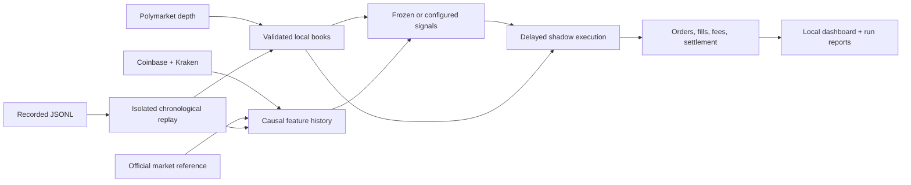

# Architecture

[README](../README.md) · [Usage](USAGE.md) · [Replay contract](REPLAY_FORMAT.md)

BTC LAB is a Python research application with a small local HTTP dashboard and a static documentation site. There is no trading server behind the GitHub Pages website.

## Code map

| Module | Responsibility |
| --- | --- |
| `btc_v3/feeds/` | Public collectors, read-only reference adapter, source clocks, resolution validation and recovery |
| `btc_v3/state/` | Book synchronization/integrity and layered readiness diagnostics |
| `btc_v3/storage/` | Separate market, external and research SQLite schemas/stores |
| `btc_v3/features/` | Features constrained by both source time and actual receipt time |
| `btc_v3/models/` | TWAP-aware research model and calibration diagnostics |
| `btc_v3/strategies/` | Typed signal families, versioned profiles and configured replay adapter |
| `btc_v3/forensics/forward_lab.py` | Original shadow strategies, execution guards, position accounting and tournament |
| `btc_v3/replay/` | Immutable event contracts, bounded readers and causal replay timers |
| `btc_v3/forensics/lab_web.py` | Local version/replay/history API; no collector launch route |
| `btc_v3/forensics/dashboard_v4.py`, `workbench_ui.py` | Four-tab UI and bounded observation projections |
| `btc_v3/forensics/browser_dashboard.py` | Loopback HTTP server, origin/host guards and entry point |
| `btc_v3/cli.py` | Explicit offline and collector commands |

## Timing and execution

Every observation has distinct source, receipt and processing clocks. Replay preserves causal processing order and advances delayed actions between observations. UTC timestamps represent events; monotonic timing measures latency and continuity. Receipt of old source data does not refresh it.

Execution rechecks identity and actual market deadline, book age at both clocks, integrity, side requirements, tick size, minimum submission size, fees and available depth. FAK fills can be partial. Independent shadow arms consume separate counterfactual liquidity; they are not pooled into a portfolio. Finalized positions cannot accept late fills or settle twice.

BOOK_CONFIRM_75 signal scheduling/confirmation and frozen tournament profiles remain distinct from user-edited strategy versions. A custom saved definition cannot rewrite a frozen benchmark or its historical results.

## Persistence and boundaries

The dashboard uses bounded, cached read-only projections of existing session/source stores. Strategy edits are written only to a dedicated version catalog; replay executes in isolated temporary stores and writes a new immutable JSON report. Same-origin/loopback checks protect local write routes. The web UI does not initialize an account, launch collectors, sign exchange orders or reset historical state.

New stores do not create the removed persistent-account or selector tables. Existing legacy tables and standalone reports are not dropped or migrated by the product cleanup.

## Research provenance

Reports retain input identity, strategy configuration hashes and execution/model/feed/settlement policy revisions. Current shadow replay is `research_shadow_replay_v3`, accounting `research_shadow_ledger_v1`; execution admission remains `phase595_dual_clock_execution_v1`. A validated caller-supplied resolution permits shadow settlement but does not prove independent exchange verification. Missing outcomes stay unresolved.

Historical cohorts with different policies are not interchangeable. Synthetic fixture PnL is a software example, not performance evidence. Prospective feed coverage, resource stability, calibration and strategy edge need separate observation.
